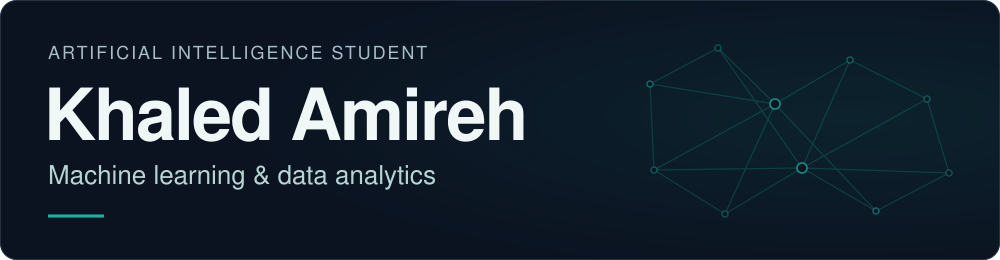
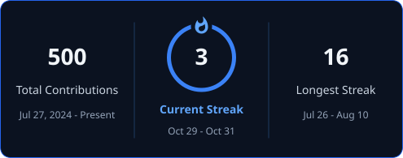

  <picture>
    <source media="(prefers-reduced-motion: no-preference)" srcset="assets/profile-hero.svg" />
    
  </picture>

  <picture>
    <source media="(prefers-reduced-motion: no-preference)" srcset="assets/focus-typing.svg" />
    
  </picture>

I build Python models for fraud detection, customer analytics, and data-driven prediction.

**[Explore my portfolio →](https://portfolio-1kpn.onrender.com)** · [LinkedIn](https://www.linkedin.com/in/khaled-amireh-0633b3355/)

## About me

I'm an **Artificial Intelligence student at Al-Zaytoonah University of Jordan**, with expected graduation in **February 2028**. I build practical projects in machine learning and data analytics, working from data preparation through model evaluation.

My completed **[Oracle Cloud technical training](#experience-and-certification)** added experience with SQL and enterprise reporting. Alongside these foundations, I'm exploring deep learning, NLP, LLMs, and AI automation.

## Tech stack

- **Programming:** Python · SQL
- **Machine learning & data:** scikit-learn · Pandas · NumPy
- **Visualization & analytics:** Matplotlib · Seaborn · Power BI · Excel
- **Tools & platforms:** Git · GitHub · VS Code · Jupyter Notebook · Google Colab · Oracle Fusion Cloud ERP

## Featured projects

Results are from saved notebook evaluations; external validation is not reported.

<table>
<tr>
<td width="1000" valign="top">
  01 / FRAUD DETECTION
  <h3><a href="https://github.com/khaled-amireh/Credit-Card-Fraud-Detection">Credit Card Fraud Detection</a></h3>
  
Engineers transaction-time features and fits a class-weighted, 150-tree Random Forest, with categorical encoding learned from training data.

  
<strong>Tools:</strong> Python · scikit-learn · Pandas 
  <strong>PR-AUC 0.8610</strong> on the supplied simulated test set.

</td>
</tr>
</table>

<table>
<tr>
<td width="1000" valign="top">
  02 / CUSTOMER ANALYTICS
  <h3><a href="https://github.com/khaled-amireh/Customer-Churn-Prediction">Customer Churn Prediction</a></h3>
  
Classifies churn from customer activity and subscription fields with Logistic Regression. One-hot encoding and scaling are fitted on training data.

  
<strong>Tools:</strong> Python · scikit-learn · Pandas 
  <strong>83.16% accuracy</strong> on one 80/20 train/test split.

</td>
</tr>
</table>

<table>
<tr>
<td width="1000" valign="top">
  03 / SPORTS ANALYTICS
  <h3><a href="https://github.com/khaled-amireh/Football-Player-Value-Prediction">Football Player Value Prediction</a></h3>
  
Estimates FIFA dataset valuations from 14 numeric player attributes with a 300-tree Random Forest, supported by residual and feature-importance analysis.

  
<strong>Tools:</strong> Python · scikit-learn · Matplotlib 
  <strong>R² 0.9877</strong> on one 80/20 train/test split.

</td>
</tr>
</table>

<table>
<tr>
<td width="1000" valign="top">
  04 / CUSTOMER SEGMENTATION
  <h3><a href="https://github.com/khaled-amireh/Customer-Segmentation-RFM">Customer Segmentation · RFM</a></h3>
  
Builds recency, frequency, and spending profiles, then compares four-cluster K-Means and Ward solutions after log transformation and scaling.

  
<strong>Tools:</strong> Python · Pandas · scikit-learn 
  <strong>Silhouette 0.3663</strong> for K-Means; internal cluster evaluation.

</td>
</tr>
</table>

<table>
<tr>
<td width="1000" valign="top">
  05 / ASSOCIATION RULES
  <h3><a href="https://github.com/khaled-amireh/Ecommerce-Market-Basket">E-Commerce Market Basket Analysis</a></h3>
  
Builds baskets from filtered UK invoices and mines Apriori association rules among the 100 most frequent products.

  
<strong>Tools:</strong> Python · Pandas · mlxtend 
  <strong>Lift 16.02</strong> for one saved rule in the filtered baskets; descriptive association.

</td>
</tr>
</table>

<table>
<tr>
<td width="1000" valign="top">
  06 / REGRESSION
  <h3><a href="https://github.com/khaled-amireh/House-Price-Prediction-MLR">House Price Prediction</a></h3>
  
Estimates Ames house prices with multiple linear regression, missing-value handling, and categorical encoding.

  
<strong>Tools:</strong> Python · Pandas · scikit-learn 
  <strong>Recorded R² 0.741</strong> on one 80/20 split. Pre-split preprocessing may inflate this score.

</td>
</tr>
</table>

**[View All Projects →](https://github.com/khaled-amireh?tab=repositories)** · [Explore project details on my portfolio](https://portfolio-1kpn.onrender.com)

## Experience and certification

### Oracle Cloud Technical Trainee

Software consultancy · **July 2026 – September 2026** · Completed training

- Worked with **Oracle SQL** queries, report datasets, and reporting data models in **Oracle Fusion Cloud ERP**.
- Tested queries and debugged reporting issues during technical training.

**PCEP — Certified Entry-Level Python Programmer** · Python Institute · [Verify credential](https://www.credly.com/badges/5a6013f7-a111-40f5-92f9-f02e5b423238/public_url)

## GitHub streak

  

<!-- streak-snapshot:start -->

Latest available snapshot · Retrieved 2026-10-31 12:03 (Asia/Amman)

<!-- streak-snapshot:end -->

Refresh scheduled every 4 hours · GitHub contributions may take up to 24 hours to appear · <a href="https://github.com/khaled-amireh?tab=overview">View contributions</a>

## Connect

Open to AI/ML internships and project collaboration.

**[Portfolio →](https://portfolio-1kpn.onrender.com)** · [GitHub](https://github.com/khaled-amireh) · [LinkedIn](https://www.linkedin.com/in/khaled-amireh-0633b3355/) · [khaledamireh55@gmail.com](mailto:khaledamireh55@gmail.com)
